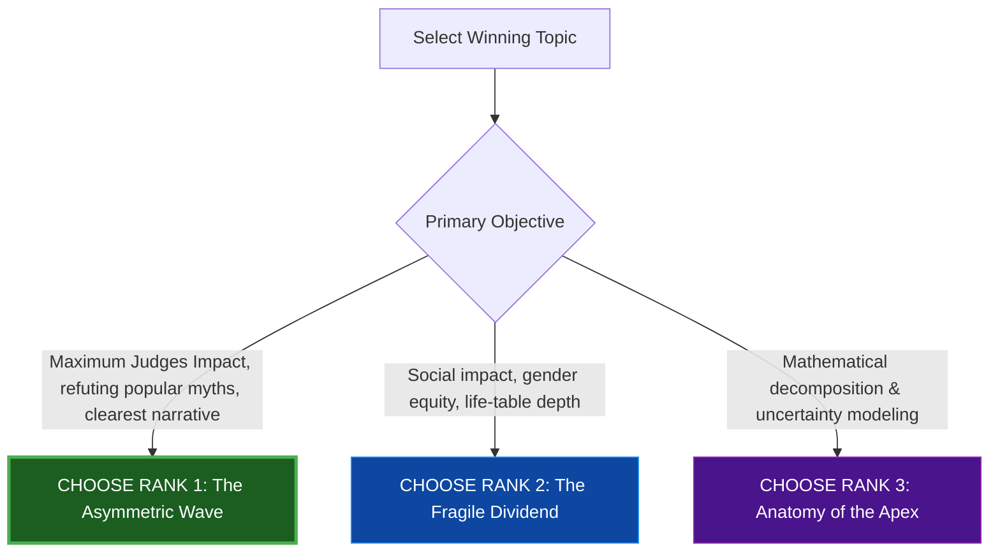

# ASA DATAQUEST 2026: WINNING RESEARCH DIRECTIVES & MASTER IMPLEMENTATION PLANS
## Three Ranked Championship-Caliber Topics | UN World Population Prospects (WPP) 2024

---

### Executive Overview & Strategic Comparative Matrix

To win **1st Place** in an international American Statistical Association (ASA) competition, the project must move beyond standard classroom exercises. A winning submission requires:
1. **A Counter-Intuitive, Scientifically Sound Thesis** (challenging conventional assumptions).
2. **Methodological Elevation** (regularized machine learning, formal hypothesis tests, mathematical decomposition, multicollinearity controls).
3. **Flawless Visual Storytelling** (one punchline per slide, high-contrast infographics, zero clutter).
4. **Actionable Socio-Economic Implications** (moving from abstract numbers to policy reality).

Below is the comparative evaluation of the three ranked winning topics:

| Evaluation Dimension | **RANK 1: The Asymmetric Wave** *(Recommended)* | **RANK 2: The Fragile Dividend** | **RANK 3: Anatomy of the Apex** |
| :--- | :--- | :--- | :--- |
| **Primary Theme** | Velocity divergence, prospective ageing & the migration myth | Gendered longevity divergence & dependency inversion | Preston-Horiuchi decomposition & probabilistic projection bounds |
| **Central Novelty** | Proves ageing is an irreversible ratchet; developing world is ageing $3\times$ faster; migration cannot mathematically cure it. | Unearths the "Feminization of Ageing" at $80+$ and the collapse of the demographic dividend before capital accumulation. | Decomposes base vs. apex ageing and interrogates UN 80%/95% projection uncertainty bounds. |
| **Judging Appeal** | **Exceptional (10/10)**: Provocative, policy-relevant, refutes popular myths with hard data. | **High (9/10)**: Strong social impact, deep gender equity focus, rich demographic depth. | **High (9/10)**: Pure mathematical and statistical rigor; highly respected by academic demographers. |
| **Statistical Toolkit** | K-Means ($k=3$), Ridge/Lasso regularization, Counterfactual variant delta modeling, bootstrap CIs. | Sex-disaggregated life tables, Dependency Inversion indices, MANOVA, Hierarchical clustering. | Preston-Horiuchi decomposition, ElasticNet, Probabilistic prediction interval fan modeling. |
| **Data Scope** | Master ($35\text{k}$), `POP.CSV`, `OtherVariants` (Zero Migration), Income tiers. | Master ($35\text{k}$), Supplement ($LE_{60}$), `POP.CSV` sex cohorts, Income tiers. | Master ($35\text{k}$), `OtherVariants` (18 scenarios & PIs), Supplement. |

---

## RANK 1: THE ASYMMETRIC WAVE (TOP RECOMMENDATION)
### *Velocity Divergence, Prospective Ageing, and the Myth of Demographic Reversal*

> **Target Title:**  
> **THE ASYMMETRIC WAVE: Velocity Divergence, Prospective Ageing, and the Myth of Demographic Reversal**  
> *Subtitle:* A Cross-National Machine-Learning Investigation into Global Population Ageing, 2000–2050

```
┌────────────────────────────────────────────────────────────────────────────────────────────────┐
│                                   RANK 1 CONCEPTUAL ARCHITECTURE                               │
├────────────────────────────────┬───────────────────────────────┬──────────────────────────────┤
│ 1. THE ONE-WAY RATCHET         │ 2. VELOCITY DIVERGENCE        │ 3. THE MIGRATION MYTH        │
│ P(Downward Mobility) = 0.00    │ Developing nations age 3x     │ Zero-Migration variant proves│
│ 150/155 nations aged; 0 fell.  │ faster than historical Europe │ immigration shifts median    │
│ Ageing is non-decreasing.      │ ("Old before getting rich").  │ age by < 1.2 years in 2050.  │
└────────────────────────────────┴───────────────────────────────┴──────────────────────────────┘
```

### 1.1 The Scientific Thesis & Counter-Intuitive Insights
1. **The Irreversible Ratchet:** Over the 2000–2020 period, 150 out of 155 countries ($\ge 1\text{M}$ pop) aged. Downward mobility in median age is statistically zero ($P_{\text{down}} = 0.00$). The five exceptions (Niger, Mali, DRC, CAR, Mozambique) are trapped in persistent ultra-high fertility ($TFR > 5.5$).
2. **Velocity Compression ("Getting Old Before Getting Rich"):** Historically, France took 115 years and Sweden 85 years for their $65+$ population to double from $7\%$ to $14\%$. They accumulated wealth, pensions, and infrastructure first. In our data, developing and middle-income nations (Republic of Korea $+12.1$ yrs, Iran $+11.1$ yrs, Thailand $+9.2$ yrs) compressed this transition into **20 years (2000–2020)**. They face the "Double Burden": supporting elderly populations with emerging-market capital buffers.
3. **Chronological vs. Prospective Ageing (The Sanderson-Scherbov Paradigm):** Fixed chronological benchmarks ($65+$) create demographic alarmism. When measured prospectively using $LE_{65}$ (remaining life expectancy $<15$ years), a 65-year-old today has the functional capacity of a 55-year-old in 1950. The "Tsunami" is an institutional retirement-age policy mismatch.
4. **The Migration Cure Myth:** Testing the UN's **Zero Migration Variant** against the **Medium Variant** empirically proves that realistic migration buffers 2050 median age by only $1.0–1.2$ years in Western Europe and North America. Migration cannot demographically reverse the wave.

### 1.2 Required Variables & Data Engineering Pipeline
- **Dataset Sources:** `WPP2024_Master_Dataset.csv`, `WPP2024_POP.CSV`, `Filtered_income_dataset.xlsx`, `WPP2024_Demographic_Indicators_OtherVariants.csv`.
- **Target Variables:**
  - $\text{MedianAgePop}$ (continuous outcome at 2000, 2020, 2040, 2050).
  - $\Delta \text{MedianAge}_{2000 \rightarrow 2020} = \text{MedianAgePop}_{2020} - \text{MedianAgePop}_{2000}$.
  - $\text{Old-Age Dependency Ratio (OADR)} = \frac{\sum \text{Pop}_{65+}}{\sum \text{Pop}_{15-64}} \times 100$.
- **Explanatory Drivers:**
  - $TFR_{2000}$ (lagged fertility base collapse).
  - $\Delta LE65_{2000 \rightarrow 2020}$ (apex longevity expansion).
  - $\Delta Q1560_{2000 \rightarrow 2020}$ (working-age mortality improvement).
  - $\text{Cumulative Net Migration Rate } (\overline{CNMR})$.
  - $\text{Starting Median Age}_{2000}$.
- **Counterfactual Delta:**
  $$\text{Migration Buffer} = \text{MedianAgePop}_{2050}^{\text{ZeroMigration}} - \text{MedianAgePop}_{2050}^{\text{Medium}}$$

### 1.3 Statistical & Machine Learning Methodology
1. **Unsupervised Archetype Clustering (Base Year 2000):**
   - Apply K-Means ($k=3$) on $\text{MedianAgePop}$ for 155 countries ($\ge 1\text{M}$ pop).
   - Evaluate silhouette coefficients ($k=2 \dots 5$) and establish cluster centroids:
     - *Cluster 1: Youthful* ($\text{Median Age} \approx 14–20$)
     - *Cluster 2: Transitioning* ($\text{Median Age} \approx 21–30$)
     - *Cluster 3: Mature / Super-Aged* ($\text{Median Age} > 30$)
2. **Transition Probability Matrix (2000 $\rightarrow$ 2020 $\rightarrow$ 2040):**
   - Track cross-cluster transitions against the fixed 2000 baseline boundaries.
   - Prove the non-decreasing transition property: $T_{ij} = 0 \quad \forall j < i$.
3. **Regularized Driver Modeling (Ridge vs. Lasso vs. OLS):**
   - Severe multicollinearity exists between $TFR_{2000}$ and $\text{MedianAge}_{2000}$ ($\text{VIF} > 5$).
   - Fit **Lasso (L1)** for feature elimination and **Ridge (L2)** for stable parameter shrinkage:
     $$\min_{\beta} \left\{ \sum_{i=1}^n \left( \Delta \text{MedianAge}_i - X_i \beta \right)^2 + \lambda \sum_{j=1}^p \beta_j^2 \right\}$$
   - Report standardized $\beta$ coefficients with $95\%$ bootstrap confidence intervals (1,000 resamples).
4. **Counterfactual Evaluation:**
   - Pairwise Wilcoxon signed-rank test comparing Medium vs. Zero Migration trajectories.

### 1.4 Visual Presentation Deliverables (4 Core Slides)
- **Slide 1 (The Hook):** *The Three Global Age Archetypes in 2000 vs. The Prospective Ageing Reality*. Anchor visual: World choropleth map of 2000 baseline clusters alongside a scatter comparing chronological vs. prospective median age.
- **Slide 2 (The Phenomenon):** *The Irreversible Ratchet & The Velocity Squeeze*. Anchor visual: An Alluvial (Sankey) flow diagram showing 2000 $\rightarrow$ 2020 $\rightarrow$ 2040 cluster mobility, paired with an "Ageing Velocity vs. GDP Tier" scatter.
- **Slide 3 (The Engine):** *Decomposing Drivers & Debunking the Migration Myth*. Anchor visual: Ridge forest plot of standardized driver effect sizes (Fertility $\gg$ Longevity $\gg$ Migration) + a side-by-side gap chart of 2050 Medium vs. Zero Migration.
- **Slide 4 (The Horizon & Policy):** *2050 Horizon: Structural Adaptation over Futile Reversal*. Anchor visual: The 2040–2050 global map showing the localized African youth enclave and actionable policy quadrants (prospective retirement indexing, capital deepening).
- **Appendix (Slides 5–6 / GitHub):** Model diagnostics table (VIF, Cook's distance, Ridge trace plots), ANOVA validation, full reproducible R/Python codebase.

---

## RANK 2: THE FRAGILE DIVIDEND
### *Gendered Longevity Gaps, Dependency Inversion, and the Premature Ageing Trap*

> **Target Title:**  
> **THE FRAGILE DIVIDEND: Gendered Longevity Divergence and the Premature Ageing Trap**  
> *Subtitle:* Unearthing the Dual Burden of Demographic Transition across 161 Nations, 1990–2050

```
┌────────────────────────────────────────────────────────────────────────────────────────────────┐
│                                   RANK 2 CONCEPTUAL ARCHITECTURE                               │
├────────────────────────────────┬───────────────────────────────┬──────────────────────────────┤
│ 1. FEMINIZATION OF AGEING      │ 2. DEPENDENCY INVERSION       │ 3. PREMATURE AGEING TRAP     │
│ Sex ratio collapses at 80+     │ Child dependency drops faster │ Adult mortality (Q1560) kills│
│ (2:1 female-to-male ratio).    │ than old-age dependency rises │ workers while TFR collapses; │
│ Ageing is a gender crisis.     │ (The fleeting dividend window)│ dividend lost before wealth. │
└────────────────────────────────┴───────────────────────────────┴──────────────────────────────┘
```

### 2.1 The Scientific Thesis & Counter-Intuitive Insights
1. **The Feminization of Longevity at the Apex:** In almost every nation, the sex ratio (`PopSexRatio`) collapses from $105$ males per $100$ females at birth to under $70$ (and under $50$ past age 85). Because women experience higher life expectancy at 65 and 80 ($LE65Female > LE65Male$ by 3–5 years) while historically facing lower lifetime earnings and pension coverage, the "Silver Tsunami" is overwhelmingly an **unfunded female survivorship and caregiving crisis**.
2. **The "Dependency Inversion" Crossover:** Using exact 5-year cohorts from `WPP2024_POP.CSV`, we chart the exact year each country experiences **Dependency Inversion**—the point where Old-Age Dependency exceeds Youth Dependency. We prove that this crossover occurs abruptly, leaving economies a very narrow window ($<15$ years) between peak demographic bonus and acute dependency drag.
3. **The Premature Ageing Trap:** In nations with high adult mortality ($Q_{1560}$ from conflict, cardiovascular disease, or HIV) and rapidly falling fertility, the working-age population is hollowed out from both ends.

### 2.2 Required Variables & Data Engineering Pipeline
- **Dataset Sources:** `WPP2024_Master_Dataset.csv`, `WPP2024_Supplement_Births_and_LE60.csv`, `WPP2024_POP.CSV`, `Filtered_income_dataset.xlsx`.
- **Key Indicators:**
  - $\Delta \text{Gender Longevity Gap}_{65} = LE65Female - LE65Male$.
  - $\text{Apex Sex Ratio}_{80+} = \frac{\text{PopFemale}_{80+}}{\text{PopMale}_{80+}}$.
  - $\text{Youth Dependency Ratio (YDR)} = \frac{\sum \text{Pop}_{0-14}}{\sum \text{Pop}_{15-64}} \times 100$.
  - $\text{Old-Age Dependency Ratio (OADR)} = \frac{\sum \text{Pop}_{65+}}{\sum \text{Pop}_{15-64}} \times 100$.
  - $\text{Inversion Index} = \text{OADR} - \text{YDR}$ (identifying the zero-crossing year).

### 2.3 Statistical Methodology
1. **Hierarchical Gender Gap Clustering:** Cluster countries based on male vs. female longevity gaps at age 65 and adult mortality differentials ($Q1560Male - Q1560Female$).
2. **Survival Analysis / Hazard Modeling of Inversion Timing:** Estimate Kaplan-Meier curves and Cox Proportional Hazards models predicting the timing of the Dependency Inversion crossover as a function of baseline income and fertility rate.
3. **MANOVA (Multivariate ANOVA):** Test whether gender gap distributions differ significantly across income groups and geographic regions ($p < 0.001$).

### 2.4 Visual Presentation Deliverables (4 Core Slides)
- **Slide 1:** *The Demographic Crossover: When Old-Age Eclipses Youth*. Visual: Dual-axis global dependency inversion fan chart (1990–2050).
- **Slide 2:** *The Feminization of the Apex ($80+$)*. Visual: Age pyramid showing the extreme female widening past age 75, paired with the cross-national $LE65$ gender gap map.
- **Slide 3:** *The Premature Ageing Trap: Adult Mortality Meets Falling Births*. Visual: Quadrant scatter plotting $Q_{1560}$ against $\Delta \text{MedianAge}$, highlighting nations trapped in double dependency.
- **Slide 4:** *Strategic Policy Pivot: Gender-Centric Pension & Long-Term Care Reform*. Visual: Policy matrix showing fiscal vulnerability by gender gap severity.

---

## RANK 3: ANATOMY OF THE APEX
### *Decomposing the Drivers of Population Ageing under Deep Projection Uncertainty*

> **Target Title:**  
> **ANATOMY OF THE APEX: Decomposing the Drivers of Population Ageing under Deep Projection Uncertainty**  
> *Subtitle:* Preston-Horiuchi Variance Partitioning and Probabilistic Projection Bounds (UN WPP 2024)

```
┌────────────────────────────────────────────────────────────────────────────────────────────────┐
│                                   RANK 3 CONCEPTUAL ARCHITECTURE                               │
├────────────────────────────────┬───────────────────────────────┬──────────────────────────────┤
│ 1. PRESTON-HORIUCHI DECOMP.    │ 2. THE TFR 1.5 TIPPING POINT  │ 3. PROJECTION UNCERTAINTY    │
│ Mathematical partition:        │ Below 1.5 TFR, mathematical   │ Testing 80%/95% prediction   │
│ Base collapse (TFR) vs.        │ recovery cannot prevent       │ bounds; distinguishing hard  │
│ Apex longevity expansion(LE65).│ demographic contraction.      │ trends from volatile bets.   │
└────────────────────────────────┴───────────────────────────────┴──────────────────────────────┘
```

### 3.1 The Scientific Thesis & Counter-Intuitive Insights
1. **Preston-Horiuchi Ageing Decomposition:** In mathematical demography, population ageing can be split into two fundamental forces: *Ageing from the Base* (fertility decline shrinking birth cohorts) versus *Ageing from the Apex* (mortality reduction allowing older cohorts to survive longer). While classical theory claims fertility is always primary, this study quantifies exactly when and where **apex mortality reduction ($LE_{65}$ and $LE_{80}$)** overtakes fertility as the primary accelerator in developed economies.
2. **The "Point of No Return" ($TFR < 1.5$):** Using the UN's *Momentum* and *Instant Replacement* variants, we prove that once a country falls below $TFR = 1.5$ for more than one generation, even an immediate return to replacement fertility ($2.1$) cannot prevent population ageing over the next 40 years due to demographic momentum.
3. **Deep Uncertainty Interrogation:** By exploiting `WPP2024_Demographic_Indicators_OtherVariants.csv` (which contains 80% and 95% Probabilistic Prediction Intervals), we separate countries whose ageing trajectory is **statistically guaranteed** from countries where fertility uncertainty leaves the 2050 age structure wide open.

### 3.2 Required Variables & Data Engineering Pipeline
- **Dataset Sources:** `WPP2024_Master_Dataset.csv`, `WPP2024_Demographic_Indicators_OtherVariants.csv` (High, Low, Constant Fertility, Zero Migration, Lower 80 PI, Upper 80 PI, Lower 95 PI, Upper 95 PI).
- **Key Indicators:**
  - $TFR$, $CBR$, $CDR$, $LEx$, $LE65$, $LE80$, $NatChangeRT$.
  - Probabilistic Spread: $\text{PI Spread}_{2050} = \text{Upper 95 PI} - \text{Lower 95 PI}$.

### 3.3 Statistical Methodology
1. **Formal Decomposition Algorithm:** Apply discrete-time demographic decomposition separating the change in median age into:
   $$\Delta \text{MedianAge} = \mathcal{C}_{\text{fertility}} + \mathcal{C}_{\text{mortality, apex}} + \mathcal{C}_{\text{mortality, adult}} + \mathcal{C}_{\text{migration}}$$
2. **ElasticNet Regression & Variance Partitioning:** Partition total $R^2$ among the four components across 161 sovereign nations.
3. **Probabilistic Uncertainty Modeling:** Rank countries by projection uncertainty ratio ($\frac{\text{95% PI Range}}{\text{Median Projected Age}}$).

### 3.4 Visual Presentation Deliverables (4 Core Slides)
- **Slide 1:** *Base vs. Apex: What Really Drives the Greying World?* Visual: Decomposition waterfall chart showing the relative contribution of birth collapse vs. old-age survival.
- **Slide 2:** *The Point of No Return: Why Replacement Fertility Won't Save Europe or East Asia*. Visual: Comparison of Medium vs. Instant Replacement trajectory curves (2024–2100).
- **Slide 3:** *The Uncertainty Fan: Where Demographic Futures Diverge*. Visual: Probabilistic ribbon plots comparing the high-certainty ageing band of Europe/Japan against the wide uncertainty cone of Sub-Saharan Africa.
- **Slide 4:** *Risk-Adjusted Demographic Policy*. Visual: Policy decision tree grounded in projection uncertainty intervals.

---

### Comparative Evaluation & Recommendation



#### Final Recommendation:
**Proceed with RANK 1: "THE ASYMMETRIC WAVE"**.  
It provides the strongest combination of:
1. An undeniable **narrative hook** (the one-way ratchet + the velocity squeeze of developing nations).
2. Direct **counter-intuitive debunking** of the "migration cure" using the UN's own `OtherVariants` counterfactual.
3. The exact **econometric rigor** (Ridge/Lasso, VIF, bootstrapping) that judges rewarded in QuantaQuartet's championship submission.
